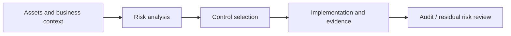

# Governance, Risk & Compliance Portfolio

**Risk assessment · NIST RMF · Audit evidence · Security controls · Identity governance**

Practical governance and security-risk exercises, including fictional business scenarios, structured assessments and an interactive password-standard study tool. The work is educational and is not presented as a paid audit or client engagement.

## Projects and evidence

| Project | Work completed | Technical record |
|---|---|---|
| **01 · CIA Triad — OSCorp** | Mapped confidentiality, integrity and availability to assets and security controls in a training scenario | [CIA Triad exercise](01-grc-mastery-course-practicals/01-cia-triad-oscorp/README.md) |
| **02 · Risk Assessment — Wayne Enterprises** | Applied a 3×3 likelihood/impact matrix, risk treatment options and prioritization in a fictional business case | [Risk assessment](01-grc-mastery-course-practicals/02-risk-assessment-wayne-enterprises/README.md) |
| **03 · Cybersecurity Audit — Foresight** | Produced a security-risk/audit deliverable in a GRC Mastery practical exercise | [Risk report (PDF)](01-grc-mastery-course-practicals/03-cyber-security-audit-foresight/risk_report_foresight.pdf) |
| **04 · NIST Risk Management Framework** | Applied the Prepare → Categorize → Select → Implement → Assess → Authorize → Monitor lifecycle to fictional CivicTrack Analytics | [NIST RMF case study](02-grc-playground/01-RMF-NIST/README.md) |
| **05 · Password Security Standards** | Studied NIST SP 800-63B Rev. 4 and developed a browser-based password policy checking tool | [Password requirements study](NIST-password-guidelines-2026/README.md) · [HTML checker](NIST-password-guidelines-2026/FREE-password-checker-NIST.html) |

## Focus: GRC applied to Identity & Access Management

These projects support a wider identity-security specialization:

- **Access governance:** role ownership, least privilege, access certification and segregation-of-duties assessment.
- **Control assurance:** clearly defined evidence, control owner, acceptance criteria and test result.
- **Risk treatment:** evaluate likelihood, impact, mitigating controls and residual exposure.
- **Audit readiness:** document decisions and retain reproducible artifacts rather than rely on unverified compliance claims.
- **Identity standards:** connect password policy, authentication strength and recovery procedures with business requirements.

### Review path

The diagram describes the assessment method, **not** a claim of implementation across a real company.

## Evidence and scope

Read each project for its scenario, assumptions and results. Fictional organizations and simulated findings are explicitly labeled; templates, standards analysis and code demonstrations should not be confused with completed production audits.

## Connected work

[Microsoft Entra Identity Labs](https://github.com/artiomcyber/Microsoft-Security) · [Cybersecurity simulations](https://github.com/artiomcyber/forage-cybersecurity-projects) · [TryHackMe](https://github.com/artiomcyber/TryHackMe)

[← GitHub profile](https://github.com/artiomcyber)
